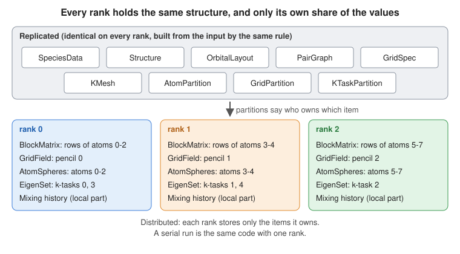
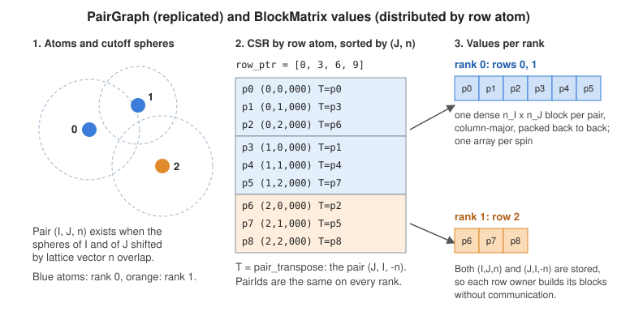
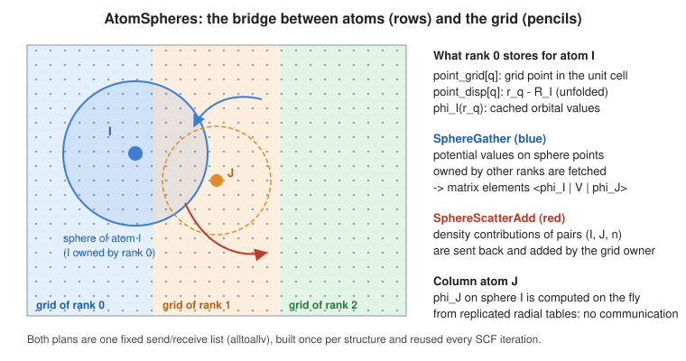
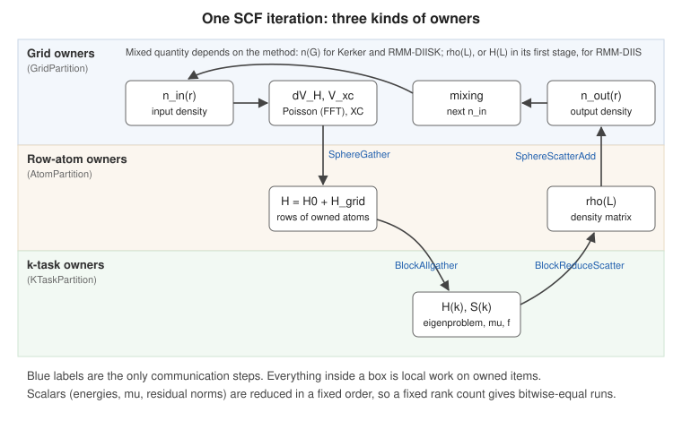
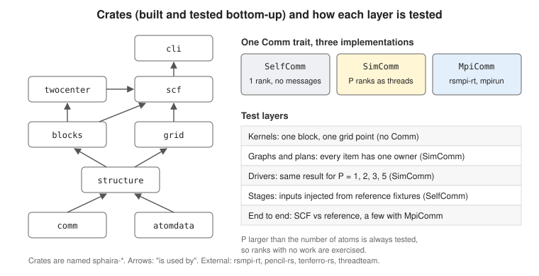

# A visual guide to the data structures [Design]

This chapter explains the design of [Data structures for a parallel SCF](data-structures.md) in pictures,
for readers who want the shape of the design before its details. Each figure is followed by the one or two ideas
it is meant to convey. Precise definitions remain in the main chapter.

## 1. Same structure everywhere, values split between ranks

- The top box holds what every rank knows: species tables, atomic positions, which atom pairs interact,
  the grid shape, the k points, and the partitions that say who owns what. These are small
  (proportional to the number of atoms), and every rank computes them itself from the input, so they never need to be sent.
- The three boxes below hold what is large: matrix blocks, grid values, orbital values on the grid, eigenvectors.
  Each rank stores only its own share.
- Running on one rank is not a special mode. It is the same picture with one box at the bottom.

## 2. How a sparse matrix is stored

- An LCAO matrix such as \\( S(\mathbf L) \\) or \\( H(\mathbf L) \\) is nonzero only for pairs of atoms whose cutoff spheres overlap.
  The list of such pairs, the **pair graph**, is grouped by the first (row) atom and sorted, so every rank numbers the pairs identically.
- Each pair also records its mirror pair \\( (J, I, -\mathbf n) \\). This makes Hermiticity checks and density-matrix symmetrization one lookup.
- The values are dense blocks, one per pair, packed one after another. A rank stores the blocks of the rows (atoms) it owns.
  Because both a pair and its mirror are stored, a rank can compute all of its blocks without asking anyone.

## 3. Where atoms meet the grid

- The density and the potential live on a real-space grid that is split between ranks in slabs or pencils.
  The atoms are split between ranks by a different rule. The two splits do not coincide.
- Every grid integral in the SCF is a sum over the grid points inside the cutoff sphere of one row atom \\( I \\).
  So each rank keeps, for each of its atoms, the list of grid points in that atom's sphere: the **atom sphere**.
- Two fixed communication patterns connect the two worlds:
  - **gather** (blue): fetch the potential at the sphere points that belong to other ranks' grid pieces,
    then compute the matrix elements \\( \langle \phi\_I \rvert V \lvert \phi\_J \rangle \\);
  - **scatter-add** (red): send the density contributions computed on the sphere back to the ranks that own those grid points.
- Orbital values of the partner atom \\( J \\) are recomputed from tables that every rank has. That costs arithmetic but no messages.

## 4. One SCF iteration

- The iteration moves between three kinds of owners: grid owners (density, potentials, FFT),
  row-atom owners (Hamiltonian and density-matrix blocks), and k-point owners (eigenproblems).
- The blue labels are the only places where data moves between ranks. Everything else is local work.
- Which quantity is mixed depends on the mixing method. For `Kerker` and `RMM-DIISK` it is the density in reciprocal space,
  which lives with the grid owners. For `RMM-DIIS` it is the density matrix, or at first the Hamiltonian,
  which lives with the row-atom owners.
- All sums are performed in a fixed order. Running twice on the same number of ranks gives bitwise-identical results.

## 5. Crates and tests

- The code is split into crates in the order the SCF needs them. Each crate can be finished and tested before the next one exists.
- All communication goes through one interface with three implementations:
  one rank; several ranks simulated by threads in one process; real MPI.
  The middle one lets ordinary `cargo test` check that the answer does not depend on the number of ranks,
  including ranks that own no atoms at all.
- Tests go from small to large: single kernels, then graphs and communication plans, then distributed drivers,
  then stages fed with reference data, and finally whole SCF runs.

## Glossary

| Term | Meaning |
|---|---|
| Rank | One process in a parallel run (or one simulated process in tests) |
| Replicated | Stored identically on every rank |
| Distributed | Split between ranks; each item has exactly one owner |
| Partition | The rule that assigns each item (atom, grid point, k point) to an owner |
| Pair graph | The list of interacting atom pairs \\( (I, J, \mathbf n) \\) |
| Block | The dense matrix of one atom pair, orbitals of \\( I \\) by orbitals of \\( J \\) |
| Atom sphere | The grid points within the cutoff radius of one atom |
| Plan | A precomputed description of who sends what to whom, reused in every iteration |
| k-task | One eigenproblem: one k point and one spin |
